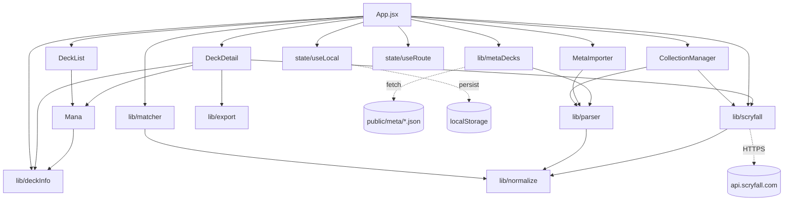

# System map

Layer:
- **UI** `components/*` — solo presentazione + eventi.
- **State** `App.jsx` + `useLocal` — fonte unica di verità.
- **Engine** `matcher.js` — funzioni pure, testate.
- **Data/API** `parser.js`, `metaDecks.js`, `scryfall.js`, `export.js`.

Sync notturno: `.github/workflows/sync-meta.yml` → `scripts/sync-mtgtop8.mjs` → MTGTop8 → `public/meta/*.json` → commit → deploy Vercel.
